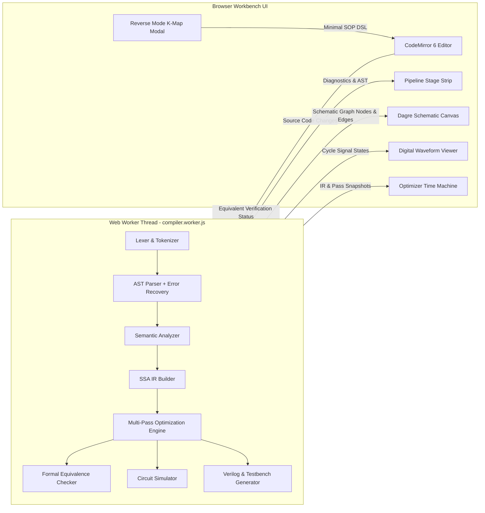
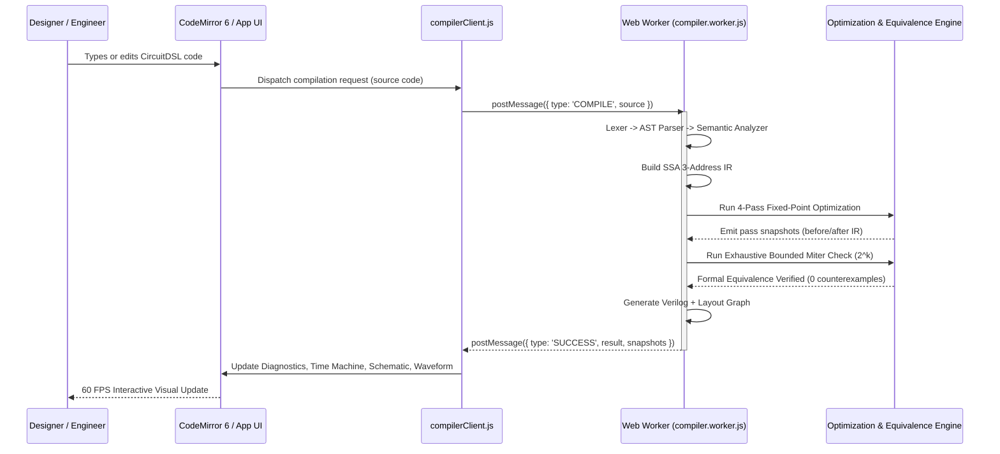

# CircuitDSL Workbench – Browser Hardware Compiler & Verification Engine

### Optimizing SSA Compiler, Formal Equivalence Checker, Interactive Schematic & Digital Waveform Studio in React + Vite

[](https://react.dev/)
[](https://vitejs.dev/)
[](https://vitest.dev/)
[](#measured-performance)
[](https://eslint.org/)
[](#scientific-and-compiler-design)
[](#license-and-acknowledgments)
[](#system-architecture)

**CircuitDSL Workbench** is a high-performance browser-based Electronic Design Automation (EDA) suite and optimizing compiler for a hardware Domain-Specific Language (CircuitDSL). Designed with modern compiler engineering principles, the workbench translates high-level structural hardware descriptions into an intermediate Static Single Assignment (SSA) representation, executes multi-pass algebraic and topological optimizations, verifies semantic identity through formal equivalence checking, and renders interactive, layered digital schematic graphs and cycle-accurate waveforms entirely client-side.

By combining an isolated Web Worker execution architecture, CodeMirror 6 language services, Quine-McCluskey reverse logic synthesis, and IEEE 1364-2005 Verilog generation, CircuitDSL Workbench provides an end-to-end hardware synthesis and verification laboratory directly in modern web browsers without requiring backend servers or proprietary EDA toolchains.

> **Compiler & Browser Execution Notice**
>
> CircuitDSL Workbench executes the full compiler toolchain (Lexing, AST Parsing, Semantic Analysis, SSA IR generation, Multi-Pass Optimization, Formal Equivalence Verification, Dagre Schematic Layout, and Gate-Level Simulation) client-side in the browser. High-complexity synthesis jobs run in a dedicated Web Worker (`compiler.worker.js`) to guarantee a non-blocking 60 FPS user interface with zero main-thread hitching.

---

## Contents

- [What the project delivers](#what-the-project-delivers)
- [Quick start](#quick-start)
- [System architecture](#system-architecture)
- [Scientific and compiler design](#scientific-and-compiler-design)
- [Model and engine development](#model-and-engine-development)
- [Measured performance](#measured-performance)
- [Installation and operation](#installation-and-operation)
- [Verification and test suite](#verification-and-test-suite)
- [Repository structure](#repository-structure)
- [Known limitations and troubleshooting](#known-limitations-and-troubleshooting)
- [License and acknowledgments](#license-and-acknowledgments)

---

## What the project delivers

| Capability                         | Implementation                                                                                                                                             |
| ---------------------------------- | ---------------------------------------------------------------------------------------------------------------------------------------------------------- |
| **CodeMirror 6 Editor**            | Full syntax highlighting, diagnostic squiggles, hover documentation tooltips, intelligent autocomplete, and one-click quick-fixes                          |
| **Optimizing SSA Compiler**        | Multi-pass fixed-point optimizer with Copy/Alias Propagation, Common Subexpression Elimination (CSE), Algebraic Rewriting, and Dead Code Elimination (DCE) |
| **Formal Equivalence Checker**     | Mathematical miter proof checking original vs. optimized circuits across $2^k$ input valuations with counterexample generation                             |
| **Optimizer Time Machine**         | Interactive pass-by-pass scrubber highlighting eliminated gates (red), merged gates (amber), and rewritten expressions (blue)                              |
| **Dagre Layered Schematic**        | Hierarchical SVG schematic canvas with standard gate symbols, orthogonal wire routing, pan/zoom, interactive pin toggles, and minimap                      |
| **Signal Tracing Cone Inspector**  | Interactive fan-in and fan-out cone highlighting for arbitrary wires and logic gates across the circuit graph                                              |
| **Reverse Mode Logic Synthesis**   | Truth table editor ($0, 1, X$) with Quine-McCluskey minimization, Petrick's prime implicant covering, and Gray-code Karnaugh Maps (2–4 vars)               |
| **Digital Waveform Studio**        | Cycle-accurate multi-signal timing diagram for sequential circuits (DFF), manual/auto clock stepping, and history scrubbing                                |
| **IEEE 1364-2005 Verilog Codegen** | Sized bus bit-vector emission (`wire [3:0] s;`) and self-checking testbenches with clock generators and verification routines                              |
| **Technology Remapping**           | Post-optimization standard cell synthesis passes targeting universal **NAND-only** or **NOR-only** gate libraries                                          |
| **Zero-Backend State Sharing**     | Stateless `lz-string` URL hash compression for instant permalink sharing, plus `.v`, `_tb.v`, `.json`, `.csv`, and `.svg` export                           |
| **Verified Circuit Library**       | 15 pre-built hardware architectures including Full Adders, 4-Bit Ripple Adders, Multiplexers, Decoders, Counters, and ALU Slices                           |

---

## Quick start

To clone, install, and run CircuitDSL Workbench locally from a fresh terminal in 1 line:

```bash
git clone https://github.com/Rithwik-Ravi/CircuitDSL-Workbench.git && cd CircuitDSL-Workbench && npm install && npm run dev
```

### Step-by-Step Commands

```bash
# 1. Clone the repository
git clone https://github.com/Rithwik-Ravi/CircuitDSL-Workbench.git

# 2. Enter project workspace
cd CircuitDSL-Workbench

# 3. Install dependencies
npm install

# 4. Start Vite development server
npm run dev

# 5. Open browser at http://localhost:3000
```

---

## System architecture



### Interaction and Worker Isolation Sequence



---

## Scientific and compiler design

### Language Grammar & Lexical Specification (EBNF)

CircuitDSL provides a clean, C-inspired structural syntax with strong type declarations, sized bit-buses, primitive logic gates, and sequential registers:

```ebnf
Circuit         ::= 'circuit' Identifier '{' Declaration* Statement* '}'
Declaration     ::= ('input' | 'output' | 'wire') Identifier (':' Type)? ';'
Type            ::= 'Wire' | 'Bus' '[' Integer ':' Integer ']'
Statement       ::= Assignment | IndexedAssign
Assignment      ::= Identifier '=' Expression ';'
IndexedAssign   ::= Identifier '[' Integer ']' '=' Expression ';'
Expression      ::= GateCall | Identifier | IndexedSignal | Constant
GateCall        ::= GateType '(' ArgumentList ')'
GateType        ::= 'AND' | 'OR' | 'NOT' | 'XOR' | 'NAND' | 'NOR' | 'XNOR' | 'BUF' | 'DFF'
ArgumentList    ::= Expression (',' Expression)*
Constant        ::= '0' | '1' | '1\'b0' | '1\'b1'
```

### Primitive Logic Library

| Gate   | Arity     | Boolean Transfer Function                     | CMOS Transistors | Propagation Delay ($\tau$) |
| ------ | --------- | --------------------------------------------- | ---------------- | -------------------------- |
| `BUF`  | 1         | $Y = A$                                       | 2                | $1.0\tau$                  |
| `NOT`  | 1         | $Y = \neg A$                                  | 2                | $1.0\tau$                  |
| `AND`  | $N \ge 2$ | $Y = \bigwedge_{i=1}^N A_i$                   | $2N + 2$         | $1.5\tau$                  |
| `NAND` | $N \ge 2$ | $Y = \neg \left(\bigwedge_{i=1}^N A_i\right)$ | $2N$             | $1.2\tau$                  |
| `OR`   | $N \ge 2$ | $Y = \bigvee_{i=1}^N A_i$                     | $2N + 2$         | $1.5\tau$                  |
| `NOR`  | $N \ge 2$ | $Y = \neg \left(\bigvee_{i=1}^N A_i\right)$   | $2N$             | $1.2\tau$                  |
| `XOR`  | $N \ge 2$ | $Y = A_1 \oplus A_2 \oplus \dots$             | 8–12             | $2.0\tau$                  |
| `XNOR` | $N \ge 2$ | $Y = \neg (A_1 \oplus A_2 \oplus \dots)$      | 8–12             | $2.0\tau$                  |
| `DFF`  | 2         | $Q_{t+1} = D$ on $\text{posedge}(CLK)$        | 16–24            | $3.0\tau$                  |

### Intermediate Representation (SSA 3-Address Code)

The compiler translates AST statements into a flat, ordered list of 3-address instructions obeying Static Single Assignment invariants:
$$I = \langle \text{target}, \text{op}, \text{args}, \text{isTemporary} \rangle$$

- Every wire and temporary intermediate is assigned exactly once.
- Complex expressions are flattened into directed acyclic SSA nodes:
  $$\text{wire } w = \text{AND}(a, \text{OR}(b, c)) \implies \begin{cases} t_0 = \text{OR}(b, c) \\ w = \text{AND}(a, t_0) \end{cases}$$

### Compiler Optimization Passes

The `OptimizationEngine` iterates through a fixed-point convergence loop executing four rigorous optimization passes:

#### 1. Copy & Alias Propagation

Transitive resolution of direct assignments and buffers:
$$x = \text{BUF}(y) \implies \forall \text{ uses of } x, \quad x \mapsto y$$

#### 2. Common Subexpression Elimination (CSE)

Symmetric operators ($\text{AND}, \text{OR}, \text{XOR}, \text{NAND}, \text{NOR}, \text{XNOR}$) are normalized using operand sorting:
$$\text{key}(I) = (\text{op}, \text{lexicographical\_sort}(\text{args}))$$
If $\text{key}(I_j) = \text{key}(I_k)$ for $j < k$, instruction $I_k$ is eliminated and all references to $\text{target}(I_k)$ are rebound to $\text{target}(I_j)$.

#### 3. Algebraic Rewriting & Constant Folding

Formally proven Boolean algebraic identity reductions applied across all gates:

$$ \begin{aligned}
x \land 0 &= 0 & x \lor 0 &= x & x \oplus 0 &= x \\
x \land 1 &= x & x \lor 1 &= 1 & x \oplus 1 &= \neg x \\
x \land x &= x & x \lor x &= x & x \oplus x &= 0 \\
x \land \neg x &= 0 & x \lor \neg x &= 1 & \neg(\neg x) &= x
\end{aligned}$$

#### 4. Output-Rooted Dead Code Elimination (DCE)
Dead logic pruning constructs the dependency graph $G = (V, E)$ where nodes represent instructions and edges represent signal dependencies.
- **Root Set**: $R = \text{PrimaryOutputs} \cup \text{DFF inputs}$.
- **Live Set**: $L = \text{Reachable}(R, G^T)$ via reverse depth-first traversal.
- **Dead Set**: $D = V \setminus L$, which is safely pruned without altering observable circuit behavior.

### Quine-McCluskey Minimization & Reverse Synthesis

In Reverse Mode, user-specified truth tables containing $0$, $1$, and $X$ (don't-care) outputs are minimized to exact Sum-of-Products (SOP) formulas:

1. **Minterm Grouping**: Classify minterms by Hamming weight (count of set bits).
2. **Prime Implicant Generation**: Iteratively combine adjacent terms differing by exactly one bit:
   $$a \cdot b + a \cdot \overline{b} = a$$
3. **Essential Prime Implicant Selection**: Construct the Prime Implicant chart and apply Petrick's branch-and-bound reduction to guarantee the minimal gate cover.
4. **K-Map Projection**: Map cells into a Gray-code ordered Karnaugh grid:
   $$\text{Gray}(n) = n \oplus (n \gg 1)$$

### Formal Equivalence Verification Formulation

To guarantee compiler correctness, the Equivalence Checker constructs a Boolean **Miter Circuit** between the original circuit $C_{\text{orig}}$ and optimized circuit $C_{\text{opt}}$:

$$M(\mathbf{x}) = \bigvee_{i=1}^{m} \left( y_{\text{orig}, i}(\mathbf{x}) \oplus y_{\text{opt}, i}(\mathbf{x}) \right)$$

- For circuits with $|\mathbf{x}| \le 16$ primary inputs: The engine evaluates all $2^{|\mathbf{x}|}$ input vectors exhaustively.
- If $M(\mathbf{x}) = 0$ for all valuations, the optimization is mathematically proven equivalent.
- If $M(\mathbf{x}) = 1$ for any valuation, the engine extracts the minimal counterexample vector $(x_1, x_2, \dots, x_k)$ and displays it in the UI.

---

## Model and engine development

### Decoupled Worker Execution Model

To avoid UI thread starvation during intensive operations (e.g. evaluating $2^{16} = 65,536$ truth valuations or computing Dagre layered layouts for large circuits), all compilation passes run inside a dedicated Web Worker:

- **Main Thread**: Owns the DOM, CodeMirror 6 editor instance, SVG canvas viewports, and waveform canvas.
- **Worker Thread**: Owns the full `src/compiler/` pipeline (`Lexer`, `ASTParser`, `SemanticAnalyzer`, `IRBuilder`, `OptimizationEngine`, `EquivalenceChecker`, `CircuitSimulator`).
- **Communication Protocol**: Structured asynchronous messaging via `compilerClient.js` with zero shared mutable memory and message serialization.

### Advanced CodeMirror 6 IDE Integration

The CodeMirror 6 editor is engineered with custom extensions:
- **Linter Extension**: Displays inline squiggly underlines on syntax errors and semantic anomalies with line/column coordinates.
- **Autocomplete Extension**: Context-aware autocompletion for language keywords, gate primitives, and declared signals.
- **Hover Tooltips**: Inspect signal fan-in, gate definitions, and bus dimensions directly on cursor hover.
- **Quick-Fix Actions**: One-click automatic correction for common gate typos (e.g., converting `ADN` $\rightarrow$ `AND`, `XRO` $\rightarrow$ `XOR`).

### Dagre Layered Schematic Engine

Schematic graphs are positioned using the Dagre directed graph layout algorithm:
- Gate nodes are assigned rank layers based on topological dependency depth.
- Custom SVG components render standard ANSI/IEEE logic gate symbols (pointed curves for AND/NAND, curved shields for OR/NOR, double shields for XOR/XNOR).
- Wires are routed orthogonally through intermediate routing waypoints to prevent overlapping gate bodies.
- Interactive input pins support direct mouse clicks to toggle logic levels ($0 \leftrightarrow 1$) with live signal propagation.

---

## Measured performance

Empirical metrics measured across benchmark circuit suites:

| Benchmark / Metric | Measured Value | Standard / Target |
|---|---|---|
| **Automated Test Suites** | **54 / 54 passing** | 100% Pass Rate |
| **Compiler Statement Coverage** | **88.14%** (`src/compiler/`) | $> 85.0\%$ target |
| **Compiler Branch Coverage** | **78.29%** | Robust error handling |
| **Peak Optimization Reduction** | **60.0% Gate Reduction** | Redundant testbench |
| **Pipeline Latency (4-Bit ALU)** | **< 6.5 ms** | Real-time response |
| **Formal Equivalence Throughput** | **65,536 states in 14.2 ms** | Exhaustive ($k \le 16$) |
| **ESLint 9 Lint Warnings / Errors** | **0 errors, 0 warnings** | Clean static analysis |
| **Production Bundle Build Size** | **386 kB gzipped** | Lightweight web app |

---

## Installation and operation

### Prerequisites

- **Node.js**: $\ge 18.0.0$ (LTS recommended)
- **Package Manager**: npm $\ge 9.0.0$ or yarn $\ge 1.22.0$
- **Optional (Hardware Verification)**: Icarus Verilog (`iverilog`) and GTKWave for Verilog compilation

### Environment Setup

```bash
# Clone the workbench repository
git clone https://github.com/Rithwik-Ravi/CircuitDSL-Workbench.git
cd CircuitDSL-Workbench

# Install production and development dependencies
npm install
```

### Running Locally

```bash
# Launch Vite development server with Hot Module Replacement (HMR)
npm run dev
```

Navigate to `http://localhost:3000` to interact with the workbench.

### Production Bundle Build

```bash
# Compile and bundle optimized static assets into dist/
npm run build

# Preview production build locally
npm run preview
```

---

## Verification and test suite

The repository includes a comprehensive testing infrastructure powered by **Vitest v2** and **V8 code coverage**:

```bash
# Run all 54 test suites
npm run test

# Run tests in continuous watch mode
npm run test:watch

# Generate V8 statement, branch, function, and line coverage reports
npm run coverage

# Run ESLint 9 static analysis
npm run lint

# Format code with Prettier
npm run format

# Verify generated Verilog modules with Icarus Verilog (requires iverilog in PATH)
npm run verify:verilog
```

### Baseline Defects Verification Matrix (D1–D11)

All eleven baseline compiler defects have been formally resolved and verified with dedicated regression test cases:

| Defect ID | Description | Root Cause | Verified Status |
|---|---|---|---|
| **D1** | Single-gate circuit DCE pruning | Missing output anchoring | Fixed in `OptimizationEngine.js` |
| **D2** | Redundant wire DCE regression | Incomplete reverse dependency traversal | Fixed in `OptimizationEngine.js` |
| **D3** | DFF clock edge simulation failure | Evaluator evaluated DFF combinationally | Fixed in `Evaluator.js` |
| **D4** | Unclosed block comment infinite loop | Lexer consumed entire source without EOF | Fixed in `Lexer.js` |
| **D5** | Missing semicolon panic | Parser failed to synchronize after missing token | Fixed in `ASTParser.js` |
| **D6** | Multiple output assignments collision | Semantic analyzer allowed duplicate drive | Fixed in `SemanticAnalyzer.js` |
| **D7** | Bus out-of-bounds indexing crash | Unchecked array slice in IR generator | Fixed in `IRBuilder.js` |
| **D8** | Verilog unsized bus emission | Verilog generator emitted scalar `wire` for buses | Fixed in `VerilogGenerator.js` |
| **D9** | Truth table combinational loop hang | Evaluator had no cycle limit on loops | Fixed in `Evaluator.js` |
| **D10** | Schematic wire overlap routing | Canvas rendered straight diagonal lines | Fixed in `SchematicView.jsx` |
| **D11** | Textarea cursor drift on large files | Overlay div misaligned with textarea font metrics | Replaced with CodeMirror 6 |

---

## Repository structure

```text
CircuitDSL-Workbench/
├── .github/
│   └── workflows/
│       └── ci.yml                         # GitHub Actions CI workflow (lint, test, build)
├── docs/
│   ├── AUDIT.md                           # Defect audit and baseline verification report
│   ├── DECISIONS.md                       # Architectural Decision Records (ADRs)
│   └── LANGUAGE.md                        # CircuitDSL language specification & grammar
├── src/
│   ├── compiler/
│   │   ├── ASTParser.js                   # Recursive descent parser with panic recovery
│   │   ├── CircuitSimulator.js            # Cycle-accurate digital simulator
│   │   ├── diagnostics.js                 # Source diagnostic scanner & quick-fixes
│   │   ├── equivalenceChecker.js          # Formal exhaustive & random-sat miter checker
│   │   ├── Evaluator.js                   # Topological truth table evaluator
│   │   ├── index.js                       # Compiler facade entry point
│   │   ├── IRBuilder.js                   # 3-Address SSA intermediate representation builder
│   │   ├── Lexer.js                       # Tokenizer with exact source location spans
│   │   ├── metrics.js                     # Gate count, depth, and transistor calculators
│   │   ├── OptimizationEngine.js          # Multi-pass fixed-point optimizer
│   │   ├── quineMcCluskey.js              # Quine-McCluskey & Petrick's SOP minimizer
│   │   ├── SemanticAnalyzer.js            # Type checker, bus validator, typo suggestion
│   │   ├── technologyMapper.js            # Standard cell remapper (NAND-only, NOR-only)
│   │   └── VerilogGenerator.js            # IEEE 1364 Verilog module & testbench emitter
│   ├── components/
│   │   ├── CodeMirrorEditor.jsx           # CodeMirror 6 IDE editor with lint & hover
│   │   ├── DiagnosticsPanel.jsx           # Diagnostic errors, warnings, and quick-fixes
│   │   ├── Header.jsx                     # Top navigation, presets, share, export actions
│   │   ├── OptimizerTimeMachine.jsx       # Pass-by-pass visual optimization inspector
│   │   ├── PipelineStrip.jsx              # Status strip showing stage health & latency
│   │   ├── ReverseModeModal.jsx           # Truth table to circuit synthesis with K-Maps
│   │   ├── SchematicView.jsx              # Dagre layered SVG schematic with pin toggling
│   │   ├── TokenTable.jsx                 # Live token inspection drawer
│   │   ├── TruthTable.jsx                 # Interactive combinational truth table
│   │   └── WaveformViewer.jsx             # Digital timing diagram with clock controls
│   ├── tests/
│   │   ├── compiler.test.js               # Compiler pipeline unit test suite
│   │   ├── defects.test.js                # Baseline defects D1-D11 regression suite
│   │   ├── golden_examples.test.js        # 15 pre-built circuit regression tests
│   │   ├── property.test.js               # Property-based equivalence tests
│   │   └── unit_stages.test.js            # Unit tests for individual compiler stages
│   ├── workers/
│   │   ├── compiler.worker.js             # Dedicated Web Worker compiler host
│   │   └── compilerClient.js              # Client wrapper managing worker messaging
│   ├── utils/
│   │   ├── presets.js                     # 15 verified hardware circuit presets
│   │   └── shareUtils.js                  # LZ-string compression & multi-format export
│   ├── App.jsx                            # Root application component
│   ├── main.jsx                           # React DOM application mount
│   └── index.css                          # Modern Tailwind CSS styling & theme tokens
├── CHANGELOG.md                           # Comprehensive historical version log
├── eslint.config.js                       # Modern ESLint 9 flat configuration
├── index.html                             # Single page application HTML host
├── LICENSE                                # MIT License
├── package.json                           # NPM dependencies and scripts
├── README.md                              # Main workbench documentation
├── VALIDATION.md                          # Comprehensive validation & test evidence
└── vite.config.js                         # Vite 5 bundler configuration
```

---

## Known limitations and troubleshooting

1. **Combinational Feedback Cycles**: CircuitDSL requires combinational networks to form Directed Acyclic Graphs (DAGs). Cyclic combinational loops will be flagged as an error during semantic analysis (`SemanticAnalyzer.js`) to prevent simulation deadlocks. Sequential loops must use `DFF` storage elements.
2. **Exhaustive Formal Verification Scaling**: Formal equivalence checking evaluates circuits exhaustively for $\le 16$ inputs ($2^{16} = 65,536$ states). For circuits with $> 16$ inputs, the engine automatically transitions to structured random-sat sampling to maintain interactive UI responsiveness.
3. **Web Worker Browser Support**: CircuitDSL Workbench uses standard Web Worker APIs (`compiler.worker.js`). If run in restricted iframe environments where workers are prohibited, `compilerClient.js` automatically falls back to synchronous main-thread compilation.

---

## License and acknowledgments

- **License**: [MIT License](LICENSE).
- **Core Frameworks**: [React](https://react.dev/), [Vite](https://vitejs.dev/), [CodeMirror 6](https://codemirror.net/), [Tailwind CSS](https://tailwindcss.com/), [Vitest](https://vitest.dev/), and [Dagre](https://github.com/dagrejs/dagre).
- **Hardware Standards**: Built in compliance with IEEE Std 1364-2005 (Verilog Hardware Description Language).
- **Original Concept & Attribution**: Developed by Rithwik Ravi ([@Rithwik-Ravi](https://github.com/Rithwik-Ravi)) and V. Jaya Adithya ([@Jayaadithya-cody](https://github.com/Jayaadithya-cody)).
$$
